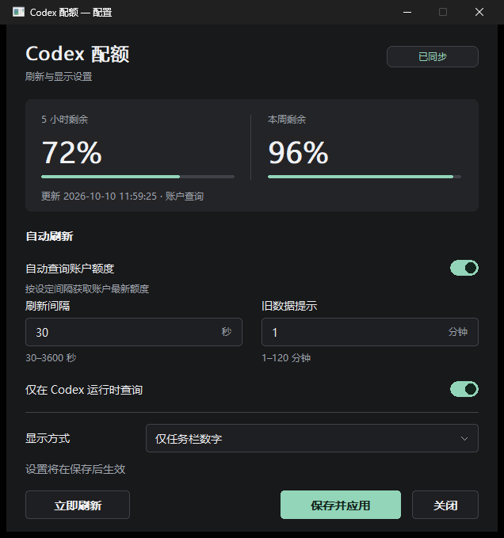

# Codex Quota Strip

[中文](README.md) | **English** · [MIT License](LICENSE) · [Contributing](CONTRIBUTING.md) · [Security](SECURITY.md) · [Changelog](CHANGELOG.md)

A lightweight Windows utility displaying **remaining five-hour quota** and **remaining weekly quota** in the system tray, with an optional strip at the top or left of the Codex window.

Built with C++17, Win32 and GDI, without Electron or WebView. This is an independent companion, not affiliated with OpenAI. **The application UI is currently Chinese. The Chinese guide is in [README.md](README.md).**



## Features

- Two numeric tray icons show remaining percentages; missing fields display `-`.
- The optional top/left strip appears while Codex is in the foreground; tray icons remain when switching applications.
- Native dark settings window for refresh interval, stale-data threshold, query conditions and display position.
- Queries default to every 120 seconds, configurable from 30–3600 seconds; the stale threshold defaults to 5 minutes, configurable from 1–120 minutes.
- Queries use locally authenticated `codex.exe app-server --stdio`; local session events provide startup and offline snapshots.
- Event-driven file notifications and incremental reads, without screen recording or screenshot monitoring; query subprocesses are cleaned up on completion, timeout or exit.
- Repeated launches with the same data directory reuse one instance.

## Environments

| Environment | Setup and limitations |
| --- | --- |
| Windows x64 + Codex desktop | Primary use case; open Codex and sign in first. A compatible `codex.exe` must be discoverable. |
| Windows PowerShell 5.1 | Use `powershell.exe`; the build entry point has been verified. |
| Windows PowerShell 7 | Use `pwsh.exe`; build and test entry points have been verified. |
| CMD / Git Bash | Invoke `powershell.exe`; do not execute `.ps1` directly in Bash. |
| Native Windows CLI | Conditional support; requires a running compatible `codex.exe` or the fallback directory below. Usually use tray-only mode. |
| WSL / Linux / macOS | No native tray version; Windows artifacts can be built through GitHub Actions as described below. WSL processes/Linux executables are not automatically discovered. |
| Windows ARM64 / headless servers | Builds target x64; ARM64 emulation is unverified. UI and integration tests require an interactive desktop. |

## Install and build

Run commands from the **repository root** unless stated otherwise. For a source ZIP, extract it and open the directory containing `Build.ps1`. This repository provides source; artifacts go into `build\`.

### Install prerequisites

You need Git, Windows PowerShell 5.1 or PowerShell 7, Visual Studio 2022 C++ Build Tools or full Visual Studio with C++ desktop development, and Windows SDK. For existing Visual Studio installations, use **Modify** in the Installer to add the required components.

If WinGet is available, use the commands below. Installers may request administrator privileges. PowerShell 7 is optional. Reopen the terminal after installation.

```powershell
winget install --id Git.Git --exact --source winget
# Optional; Windows PowerShell 5.1 also works.
winget install --id Microsoft.PowerShell --exact --source winget
winget install --id Microsoft.VisualStudio.2022.BuildTools --exact --source winget --override "--wait --passive --norestart --add Microsoft.VisualStudio.Workload.VCTools --includeRecommended"
```

Without WinGet, install manually using the official guides for [Git](https://git-scm.com/install/windows), [PowerShell](https://learn.microsoft.com/en-us/powershell/scripting/install/install-powershell-on-windows) and [Microsoft C++](https://learn.microsoft.com/en-us/cpp/build/vscpp-step-0-installation?view=msvc-170). Build Tools flags are documented in the [Visual Studio command reference](https://learn.microsoft.com/en-us/visualstudio/install/use-command-line-parameters-to-install-visual-studio?view=vs-2022).

### Get the source

```powershell
git clone https://github.com/jyongli/codex-quota-strip.git
Set-Location .\codex-quota-strip
```

### Build with your shell

Windows PowerShell 5.1:

```powershell
powershell.exe -NoProfile -ExecutionPolicy Bypass -File .\Build.ps1
```

PowerShell 7:

```powershell
pwsh.exe -NoProfile -ExecutionPolicy Bypass -File .\Build.ps1
```

CMD / Git Bash, from the repository root:

```sh
powershell.exe -NoProfile -ExecutionPolicy Bypass -File ./Build.ps1
```

The script uses `vswhere` to discover C++ tools and sets MSVC/SDK paths. A regular PowerShell session is sufficient; Developer Command Prompt is unnecessary. It selects the latest SDK with both headers and x64 libraries, skipping incomplete installations. There is no toolchain-version pinning option. Outputs are `build\CodexQuotaStrip.exe` and `build\Start-With-Codex.ps1`; running the app does not require a compiler.

Linux/macOS users can dispatch a Windows-runner build through GitHub CLI or use a Windows VM. See [Building from Linux and macOS](docs/building-on-linux-macos.md) for installation, dispatch, download and checksum commands. Outputs remain Windows `.exe` files; native Linux/macOS builds are not currently supported.

### Launch and configure

Open Codex and sign in first, then run. Right-click either tray icon to open settings, refresh immediately or exit.

```powershell
.\build\CodexQuotaStrip.exe --settings
```

## Environment configuration

Run the launch examples when the matching instance is not already running. To change its arguments or environment, exit through the tray, or use `--quit` and wait for the process to finish before launching again.

### Desktop: Store or local installation

1. Open Codex, sign in and keep its window open.
2. Open companion settings and enable online queries.
3. Choose tray-only or tray plus in-Codex display, then save and apply.
4. Click **Refresh now** and inspect the source, timestamp and status.

Discovery order: **running Windows `codex.exe` → `%LOCALAPPDATA%\OpenAI\Codex\bin\codex.exe` or its one-level version subdirectories**. There is no separate `PATH` search or `--codex-path` option. Store or other layouts require a discoverable process to be running; not all versions/layouts have been verified.

Launch from a desktop shortcut or regular Windows terminal. Terminals in some packaged applications redirect `LOCALAPPDATA`, resulting in a different settings directory from a regular desktop launch.

### Native Windows CLI

Start and sign in to the native Windows CLI, keep its `codex.exe` running, then start the companion. Disable **Query only while Codex is running** and save/apply; this condition detects the desktop window and may prevent scheduled queries with only the CLI running.

```powershell
.\build\CodexQuotaStrip.exe --taskbar --settings
```

Use tray-only mode: the CLI has no Codex desktop window to attach to. After the CLI exits, later queries may fail to find the executable unless it is in the fallback directory above.

### Custom data directories or accounts

`--home` takes precedence over `CODEX_HOME`; the default is `%USERPROFILE%\.codex`. Use the account's data directory, already initialized through Codex.

```powershell
.\build\CodexQuotaStrip.exe --home "D:\CodexData\account-a" --settings
```

To exit this instance, use the same directory:

```powershell
.\build\CodexQuotaStrip.exe --home "D:\CodexData\account-a" --quit
```

Or set the current PowerShell session environment:

```powershell
$env:CODEX_HOME = 'D:\CodexData\account-a'
.\build\CodexQuotaStrip.exe --settings
```

`--home` changes Codex data only; **companion settings are not isolated**. Instances under the same Windows user share `%LOCALAPPDATA%\CodexQuotaStrip\settings.ini`. Instance identity is based on the data directory. `--settings` opens an existing instance's settings; other arguments do not reconfigure a running instance. Exit the matching instance before changing arguments.

### Proxies and restricted networks

Query subprocesses inherit the companion's launch environment. This configures the current session only; replace the example address/port with your working HTTP proxy.

```powershell
$env:HTTPS_PROXY = 'http://127.0.0.1:7890'
$env:HTTP_PROXY = $env:HTTPS_PROXY
.\build\CodexQuotaStrip.exe --settings
```

Whether these variables are honored depends on the discovered Codex version and network configuration. The companion does not configure the system proxy. Restart from this terminal after changes; existing instances do not inherit new variables.

### Local-event mode

```powershell
.\build\CodexQuotaStrip.exe --local-only --settings
```

This initially disables online queries. Keep the online-query checkbox disabled to remain in local mode. Data depends on new session events, so account quotas may not be current while idle.

## Refresh and display settings

Use **Save and apply** in settings for immediate changes. Default INI contents and field meanings:

```ini
[refresh]
online=1
only_with_codex=1
seconds=120
stale_minutes=5

[display]
surface=taskbar
position=top
```

| Field | Default | Meaning and range |
| --- | --- | --- |
| `online` | `1` | `1` for online queries, `0` for local events |
| `only_with_codex` | `1` | require a detected desktop window for scheduled queries; manual refresh bypasses this condition |
| `seconds` | `120` | query interval, 30–3600 seconds |
| `stale_minutes` | `5` | stale threshold, 1–120 minutes; does not trigger extra queries |
| `surface` | `taskbar` | `taskbar` or `taskbar-and-codex` |
| `position` | `top` | `top` or `left`; applies only to the strip |

Before manual edits, exit the matching instance and wait for it to finish, then back up the file; restart after saving. Generate the file first by saving from the settings window.

```powershell
$quotaConfig = Join-Path $env:LOCALAPPDATA 'CodexQuotaStrip\settings.ini'
if (Test-Path -LiteralPath $quotaConfig) {
    Copy-Item -LiteralPath $quotaConfig -Destination ($quotaConfig + '.before-edit-' + (Get-Date -Format 'yyyyMMdd-HHmmss') + '.bak')
    notepad.exe $quotaConfig
}
```

After saving and closing Notepad, restart:

```powershell
.\build\CodexQuotaStrip.exe
```

Failures back off up to 15 minutes; manual queries are at least 5 seconds apart. Values represent **remaining quota**, identified by upstream window duration. Missing fields show `-`; gray values indicate stale snapshots. Failures retain the last snapshot, and updates are not guaranteed every second.

## Startup options

### Portable use or launcher integration

Keep artifacts in a fixed directory. This entry point respects saved preferences and exits PowerShell after launch, without a persistent script-monitor process. It starts the companion only, without launching Codex or modifying arbitrary Codex shortcuts.

```powershell
powershell.exe -NoProfile -WindowStyle Hidden -ExecutionPolicy Bypass -File .\build\Start-With-Codex.ps1
```

### Desktop shortcut

Use the Windows-provided desktop directory, including redirected desktops. Update the shortcut if you move the executable.

```powershell
$quotaExe = (Resolve-Path .\build\CodexQuotaStrip.exe).Path
$quotaDesktop = [Environment]::GetFolderPath('Desktop')
$quotaShortcut = (New-Object -ComObject WScript.Shell).CreateShortcut((Join-Path $quotaDesktop 'Codex Quota.lnk'))
$quotaShortcut.TargetPath = $quotaExe
$quotaShortcut.WorkingDirectory = Split-Path -Parent $quotaExe
$quotaShortcut.Save()
```

### Start at Windows sign-in

Create a shortcut in the current user's Startup folder. This starts **at Windows sign-in**, not exclusively with Codex; the default `only_with_codex=1` limits scheduled queries while the desktop app is not open.

```powershell
$quotaExe = (Resolve-Path .\build\CodexQuotaStrip.exe).Path
$quotaStartup = [Environment]::GetFolderPath('Startup')
$quotaShortcut = (New-Object -ComObject WScript.Shell).CreateShortcut((Join-Path $quotaStartup 'Codex Quota.lnk'))
$quotaShortcut.TargetPath = $quotaExe
$quotaShortcut.WorkingDirectory = Split-Path -Parent $quotaExe
$quotaShortcut.Save()
```

To disable sign-in startup, remove this shortcut from that Startup directory.

### Specific custom launcher

This installer applies only to an existing `%LOCALAPPDATA%\OpenAI\Codex\launch-with-clash.ps1` matching its checked startup anchor. It backs up the launcher, installs into `%LOCALAPPDATA%\CodexQuotaStrip` and adds one hook. It is not a generic official-installation integration; incompatible launchers cause it to stop.

```powershell
# Only for the custom launcher described above.
powershell.exe -NoProfile -ExecutionPolicy Bypass -File .\scripts\Install-CodexStartup.ps1 -SourceDirectory .\build
```

## Command reference

| Argument or command | Purpose |
| --- | --- |
| `CodexQuotaStrip.exe` | launch with saved settings |
| `--settings` | open settings, including for an existing instance |
| `--taskbar` | launch with tray icons only |
| `--taskbar-and-codex --top` | launch with tray icons and top strip |
| `--taskbar-and-codex --left` | launch with tray icons and left strip |
| `--home "path"` | select Codex data directory |
| `--local-only` | initially disable online queries |
| `--status "path"` | write diagnostic JSON; parent directory must exist |
| `--quit` | asynchronously request exit for the selected data directory |

Exit the existing instance before switching to the top strip:

```powershell
.\build\CodexQuotaStrip.exe --quit
```

Wait for the previous instance to exit before running:

```powershell
.\build\CodexQuotaStrip.exe --taskbar-and-codex --top
```

Custom build output directory:

```powershell
powershell.exe -NoProfile -ExecutionPolicy Bypass -File .\Build.ps1 -OutputDirectory .\build\portable
```

## Tests and troubleshooting

Default tests cover SDK discovery, parsing, window mapping, fragmented records, settings persistence and icon rendering. `-Integration` adds settings interactions, window recovery and real filesystem events using isolated data directories; test windows may briefly appear.

```powershell
powershell.exe -NoProfile -ExecutionPolicy Bypass -File .\Test.ps1
powershell.exe -NoProfile -ExecutionPolicy Bypass -File .\Test.ps1 -Integration
```

Replace `powershell.exe` with `pwsh.exe` for PowerShell 7. This account probe requires discoverable, signed-in Codex and contacts the account endpoint; default tests do not query the endpoint.

```powershell
powershell.exe -NoProfile -ExecutionPolicy Bypass -File .\Build.ps1 -Target ProviderProbe
.\build\ProviderProbe.exe success
```

| Symptom | Check |
| --- | --- |
| missing tools or SDK | Add C++ tools and SDK in the Installer; no system PATH change for cl.exe is needed. |
| script blocked | Use the process-level command above; organizational policy may still restrict execution. |
| hidden tray icons | Check the hidden-icons area and taskbar settings. |
| strip missing | Enable the strip; a recognized Codex window must be foreground and not minimized. CLI has no attachment window. |
| persistent `-` or failed refresh | Check sign-in, data directory, executable discovery, online setting and network; inspect status and refresh manually. |
| arguments or variables ignored | Exit with the same `--home` and relaunch; repeated launches usually reuse the old instance. |
| different settings by launch location | Compare LOCALAPPDATA; restart from a regular terminal or desktop shortcut. |

## Data and source

The utility reads session logs to extract quota events. It does not directly read `auth.json` contents, only watching changes to clear old snapshots. Local Codex handles authentication; no separate API key or model inference is used. Diagnostic logging is disabled by default, and no data is uploaded to an additional analytics service.

| File | Purpose |
| --- | --- |
| `source/QuotaStrip.cpp` | tray, strip, settings and controller |
| `source/QuotaProvider.*` | app-server queries and subprocess cleanup |
| `source/QuotaCore.h`, `QuotaFiles.h` | bounded parsing, quota mapping and incremental reads |
| `source/QuotaSettings.h`, `SettingsTheme.h` | settings and native dark UI |
| `source/TrayIcons.h` | numeric icons |
| `Build.ps1`, `Test.ps1` | build and test entry points |

## License and contribution

Source and documentation are licensed under the [MIT License](LICENSE), permitting use, modification, distribution and commercial use while retaining copyright/license notices. The software is provided as-is without warranty. Third-party tools, runtimes, Windows SDK and Codex services retain their own terms.

See [Contributing](CONTRIBUTING.md) for development, [Security](SECURITY.md) for reporting/data boundaries, and the [Changelog](CHANGELOG.md) for source changes.
